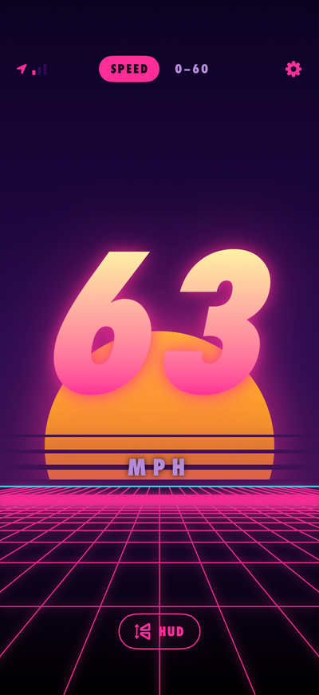
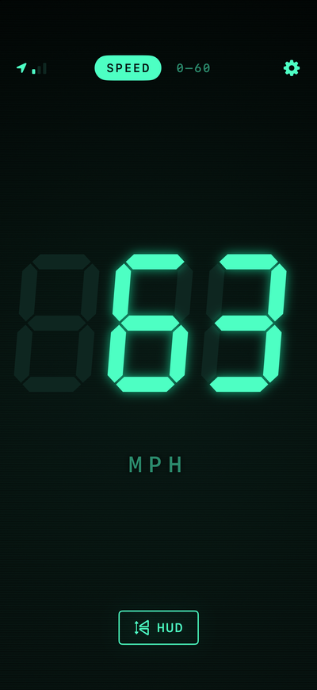
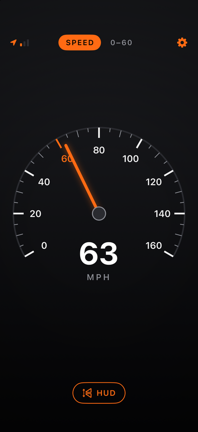
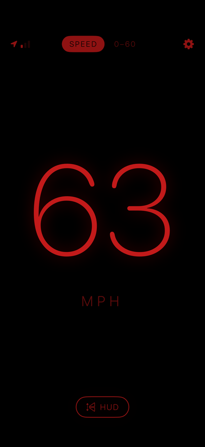
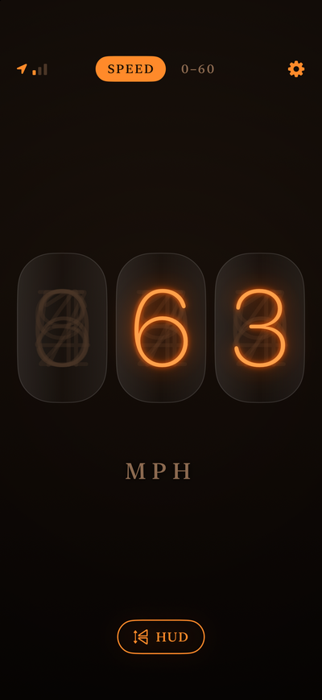
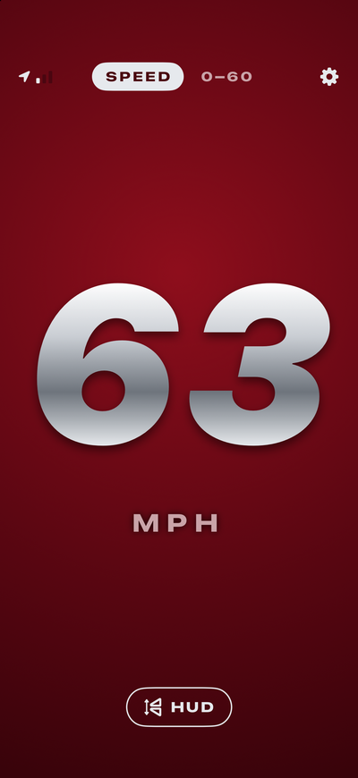
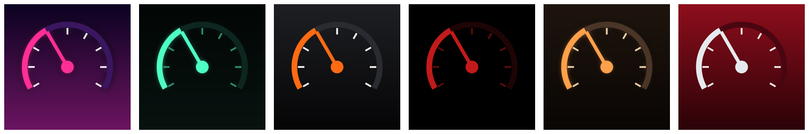

# Launch Control

An iPhone GPS speedometer and hands-free 0–60 timer, built for a 2020 Mazda MX-5 RF. See `PLAN.md` for the design and build order.

## Themes

| Outrun | LCD Dash | Gauge |
|:---:|:---:|:---:|
|  |  |  |
| **Night Drive** | **Nixie** | **Crimson** |
|  |  |  |

The app's icon follows the theme:



## What you need

- A Mac with Xcode.
- An Apple ID signed in to Xcode (**Xcode → Settings → Accounts**). A free one works, but the app then stops opening after 7 days and has to be installed again.
- iOS 17 or later.

## Install it on your iPhone

1. **Signing, once.** Copy `Local.xcconfig.example` to `Local.xcconfig` and fill in your Team ID and a bundle id prefix of your own. Set the team there, not in Xcode's Signing pane, which would change the shared project file.
2. **Connect the iPhone** to the Mac with a cable (or pair it over Wi-Fi in **Window → Devices and Simulators**), and on the iPhone turn on **Settings → Privacy & Security → Developer Mode** when Xcode asks.
3. **Install.** Run `./iphone-install`. It builds the app for the paired iPhone, installs it and opens it (the iPhone unlocked). The first time with a free account, trust the developer on the iPhone: **Settings → General → VPN & Device Management**. Run it again every 7 days. With more than one iPhone paired, name it: `./iphone-install "My iPhone"`.

## Using it

- **Speed:** the GPS speed in mph. The bars at top left show how good the GPS signal is. **HUD** flips the speed for the windshield to reflect: lay the phone flat on the dash, top edge toward the glass, and tap to leave.
- **0–60:** mount the phone firmly, upright and facing you. Stop, tap **Arm**, and hold still until it says **Ready**. Then launch: the timer starts at the first movement and stops at 60 on its own. You also get the time with a 1-ft rollout (how magazines time it), 0–30 and peak g.
- **Runs** lists every timed run, your best starred. Swipe to delete; press and hold to share a run's raw data. The raw data is also in the Files app: On My iPhone → Launch Control → Runs.
- **Settings** (the gear): the theme, and whether it speaks.

Only time runs on a track or a closed road.

## Building without a device

```bash
xcodebuild -project LaunchControl.xcodeproj -scheme LaunchControl -sdk iphonesimulator \
  -destination 'generic/platform=iOS Simulator' build
```

The timing maths (`LaunchKit/`) has unit tests that run made-up launches through it:

```bash
xcodebuild test -project LaunchControl.xcodeproj -scheme LaunchControl \
  -destination 'platform=iOS Simulator,name=iPhone 17'
```

The app icons are drawn by `make_icons.py` (needs Pillow): `python3 make_icons.py`.
